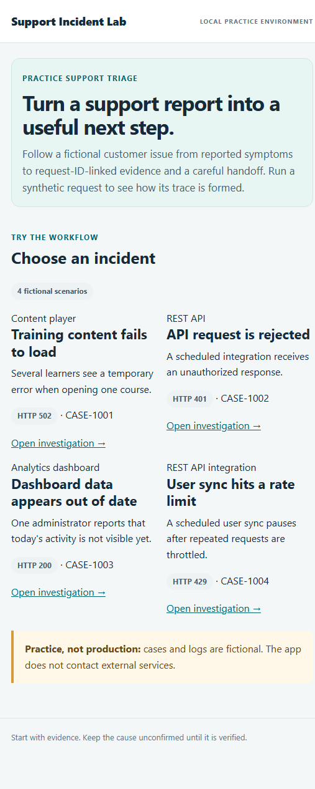
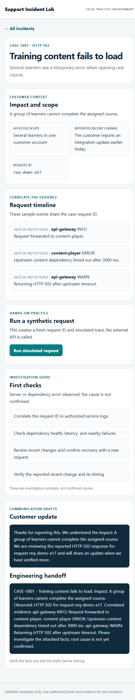

# Support Incident Investigation Lab

**A small, local Python app for practicing how to investigate SaaS support issues.**

Imagine a customer report is a puzzle. The app puts the clues—what happened,
who is affected, the request ID, and sample logs—in one place. It suggests
what to check next and helps draft a clear customer update and engineering
handoff. It does **not** guess or confirm the root cause.

Made as a hands-on learning project for support engineers: it demonstrates
Python, HTTP status codes, JSON validation, request tracing, testing, and clear
technical communication.

> All cases and logs are fictional. The app makes no calls to real services.

## See it

### Incident list



### Case investigation and simulated trace



## Run it on Windows

**You need Python 3.7 or newer. No packages need to be installed.**
The app uses only Python's standard library.

### Easiest: use VS Code

1. Open VS Code.
2. Select **File → Open Folder...** and choose this project folder.
3. If prompted, install the recommended **Python** extension.
4. Press **F5** and choose **Support Incident Lab**.
5. Open <http://127.0.0.1:8000> in your browser.

You can also double-click `run.bat`, or start the server from the VS Code
terminal:

```powershell
python app.py --serve
```

Press **Ctrl+C** in the terminal to stop it.

### Try the CLI and tests

```powershell
python app.py --list-cases
python app.py --case-id CASE-1001
python app.py --case-id CASE-1004 --simulate
python -m unittest discover -s tests -v
```

If `python` is not recognized, install Python and enable **Add Python to
PATH**, then restart VS Code. If port `8000` is busy, stop the other local
server and try again.

## How it works

1. `data/cases.json` holds fictional cases and sample log events.
2. `app.py` checks the data and suggests first investigation steps.
3. The browser or CLI shows the report. **Run simulated request** creates a
   fresh request ID and three matching synthetic events—no external request
   is made.
4. Review the evidence, then edit the customer and engineering drafts before
   sharing.

Think of the request ID like a label on a folder: it helps you find the log
events that belong to the same request.

## Project map

```text
app.py              Python logic, CLI, local server, and simulation
data/cases.json     Fictional incidents and correlated sample events
templates/          HTML pages for the incident list and reports
static/             Browser styles and simulation interaction
tests/              Automated checks for analysis, CLI, and web routes
screenshots/        Browser screenshots used in this README
.vscode/            VS Code launch setup and Python extension recommendation
run.bat             Windows one-click server launcher
```

## Safety and scope

This is a practice simulator—not a production support system. It has no
customer data, sign-in, database, external API, or live log access. Its
checklists are suggestions, not diagnoses; verify real incidents with
authorized tools and evidence.
